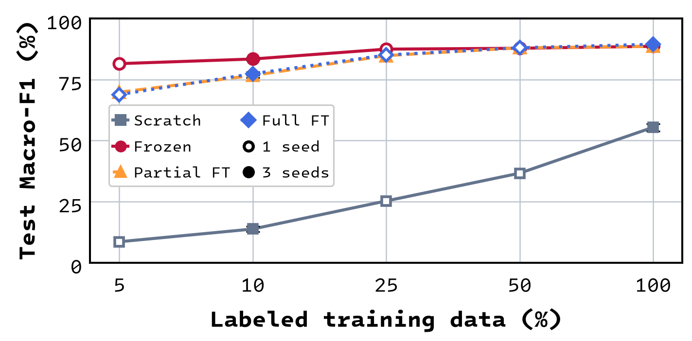
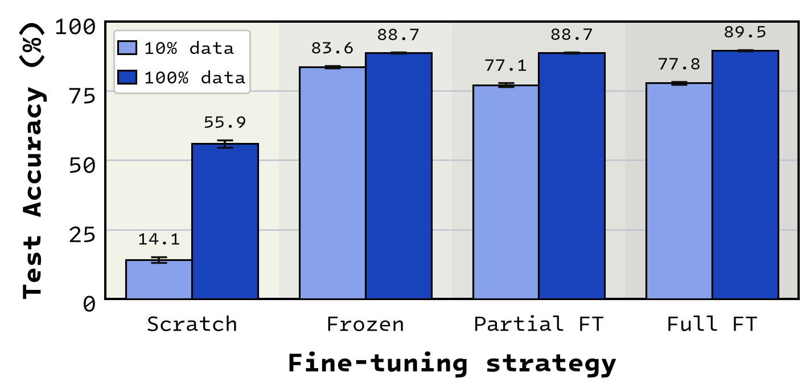
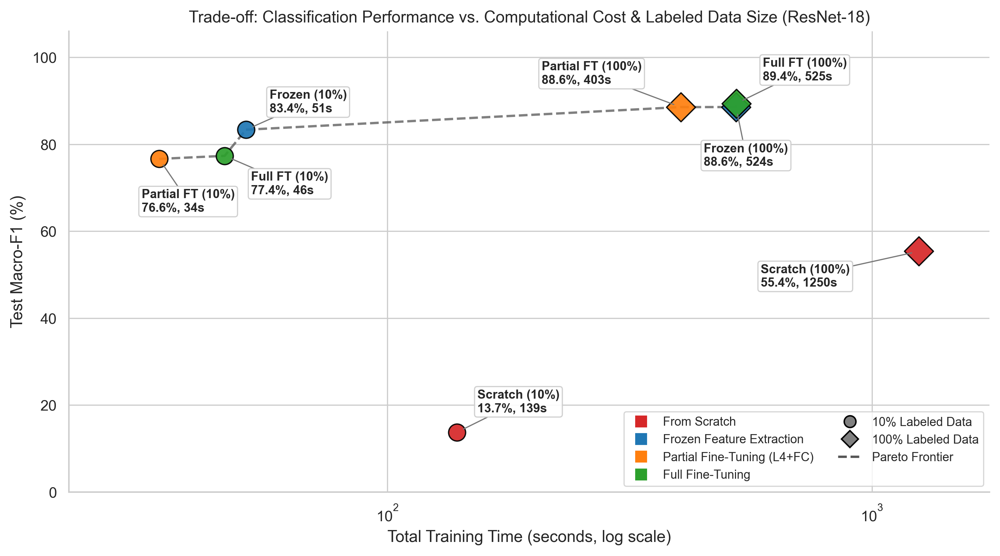

# Transfer Learning vs. Training from Scratch under Limited Labeled Data

**DSAA 5020 Final Project (Topic 8)** — An empirical study on the 37-class **Oxford-IIIT Pet** fine-grained classification benchmark comparing random initialization (*Scratch*), frozen feature extraction (*Frozen*), partial fine-tuning (*Partial FT*), and full fine-tuning (*Full FT*) across **44 controlled NVIDIA L4 GPU runs** (`ResNet-18` primary + `MobileNetV3-Small` cross-backbone validation).

- **Final 6-Page ACM Report (PDF)**: [`report/main.pdf`](report/main.pdf)
- **LaTeX Source**: [`report/main.tex`](report/main.tex) | [`report/references.bib`](report/references.bib)
- **Standalone Colab Notebook (with full L4 outputs)**: [`colab_standalone_topic8.ipynb`](colab_standalone_topic8.ipynb)
- **Aggregated Result Tables**: [`results/tables/summary_table.md`](results/tables/summary_table.md) | [`results/tables/species_f1_table.md`](results/tables/species_f1_table.md) | [`results/tables/all_runs.csv`](results/tables/all_runs.csv)

---

## Key Results (ResNet-18, 3 Seeds Mean ± Std, NVIDIA L4 GPU)

| Data % | Strategy | Trainable Params | Test Accuracy | Test Macro-F1 | Train–Val Gap | Total Time (s) |
| :---: | :--- | :---: | :---: | :---: | :---: | :---: |
| **10%** | From Scratch | 11.20M | 14.09 ± 1.09% | 13.74 ± 1.01% | +82.50% | 139.0 ± 3.0s |
| **10%** | **Frozen Feature Extraction** | **19.0K** | **83.65 ± 0.39%** | **83.37 ± 0.45%** | **+12.68%** | **51.0 ± 17.6s** |
| **10%** | Partial FT (`layer4` + `fc`) | 8.41M | 77.09 ± 0.73% | 76.65 ± 0.91% | +18.84% | 33.8 ± 3.0s |
| **10%** | Full Fine-Tuning | 11.20M | 77.81 ± 0.50% | 77.36 ± 0.65% | +18.37% | 46.1 ± 10.9s |
| **100%** | From Scratch | 11.20M | 55.95 ± 1.33% | 55.39 ± 1.48% | +37.06% | 1250.1 ± 8.0s |
| **100%** | Frozen Feature Extraction | 19.0K | 88.70 ± 0.18% | 88.58 ± 0.16% | +6.00% | 524.2 ± 105.2s |
| **100%** | Partial FT (`layer4` + `fc`) | 8.41M | 88.73 ± 0.23% | 88.57 ± 0.20% | +7.71% | 403.0 ± 48.4s |
| **100%** | **Full Fine-Tuning** | **11.20M** | **89.54 ± 0.30%** | **89.41 ± 0.31%** | +7.02% | 524.8 ± 134.2s |

### Main Findings
1. **Massive Low-Data Advantage**: On 10% labeled data (~8 imgs/class), *Frozen* updates only **0.17%** of parameters (19K) and reaches **83.65%** accuracy (+69.6 pp over *Scratch*, 2.7× faster).
2. **Low-Data Crossover**: Across 5%–25% data, *Frozen* beats *Full FT* by **+2.4 to +12.7 pp** by avoiding small-sample feature distortion; a crossover occurs at **50% data**, with *Full FT* peaking at 100% (**89.54%**).
3. **20× Label & 38× Compute Efficiency**: Even **5% *Frozen*** (81.55%, 32.6s) outperforms **100% *Scratch*** (55.95%, 1250s) by +25.6 pp.
4. **Source-Domain Asymmetry (Dog vs. Cat)**: At 100% data, dog breeds (heavily covered in ImageNet-1K) saturate under *Frozen* (91.36% vs. 91.27% *Full FT*), whereas virtually 100% of *Full FT*'s overall gain comes from under-represented cat breeds (+2.74 pp).





---

## Figure & Table Reproducibility Manifest (Data + Plotting Code)

Every figure (`Fig. 1`–`Fig. 10`) and table (`Table 2`, `Table 3`) in [`report/main.pdf`](report/main.pdf) is **100% reproducible directly from the committed raw data in `results/`**—**no GPU and no PyTorch installation required** (only `numpy`, `pandas`, `matplotlib`, `scikit-learn`).

### One-Command Reproduction of All Tables & Figures
```bash
pip install numpy pandas matplotlib scikit-learn
python -m src.visualize --output_dir results
```

### Per-Figure Data Sources, Plotting Code, and CLI Commands

| Output in Report | Saved Artifact | Underlying Raw Data (in `results/`) | Plotting / Aggregation Function | Single-Item Command |
| :--- | :--- | :--- | :--- | :--- |
| **Table 2** (All 44 Runs) | [`summary_table.md`](results/tables/summary_table.md) / [`summary_by_condition.csv`](results/tables/summary_by_condition.csv) | All 44 `metrics.json` in [`resnet18/`](results/resnet18) & [`mobilenet_v3_small/`](results/mobilenet_v3_small) → [`all_runs.csv`](results/tables/all_runs.csv) | [`build_summary_tables`](src/visualize.py#L115-L178) | `python -m src.visualize --output_dir results` |
| **Table 3** (Cat vs. Dog F1) | [`species_f1_table.md`](results/tables/species_f1_table.md) / [`species_f1_table.csv`](results/tables/species_f1_table.csv) | [`eda_summary.json`](results/eda_summary.json) + 24 ResNet-18 `test_predictions.npz` (10% & 100%, 3 seeds) | [`build_species_f1_table`](src/visualize.py#L181-L236) | `python -m src.visualize --output_dir results` |
| **Fig. 1** (EDA Class Dist.) | [`fig1_eda_class_distribution.png`](results/figures/fig1_eda_class_distribution.png) | [`eda_summary.json`](results/eda_summary.json) | [`plot_fig1_eda`](src/visualize.py#L240-L288) | `python -m src.visualize --output_dir results --figures fig1` |
| **Fig. 2** (10% Comparison) | [`fig2_model_comparison_10pct.png`](results/figures/fig2_model_comparison_10pct.png) | [`summary_by_condition.csv`](results/tables/summary_by_condition.csv) (ResNet-18, 10%, 3 seeds) | [`plot_fig2_model_comparison_10pct`](src/visualize.py#L292-L342) | `python -m src.visualize --output_dir results --figures fig2` |
| **Fig. 3a / 3b** (Data Efficiency) | [`fig3a_data_efficiency_curve.png`](results/figures/fig3a_data_efficiency_curve.png), [`fig3b_10_vs_100_accuracy.png`](results/figures/fig3b_10_vs_100_accuracy.png) | [`summary_by_condition.csv`](results/tables/summary_by_condition.csv) (ResNet-18, 5%–100%) | [`plot_fig3_data_efficiency`](src/visualize.py#L346-L443) | `python -m src.visualize --output_dir results --figures fig3` |
| **Fig. 4 / 5** (Learning Curves & Gap) | [`fig4a_generalization_curves.png`](results/figures/fig4a_generalization_curves.png), [`fig4b_generalization_gap.png`](results/figures/fig4b_generalization_gap.png) | [`scratch_f010_s42/history.csv`](results/resnet18/scratch_f010_s42/history.csv), [`frozen_f010_s42/history.csv`](results/resnet18/frozen_f010_s42/history.csv), [`partial_ft_f010_s42/history.csv`](results/resnet18/partial_ft_f010_s42/history.csv), [`full_ft_f010_s42/history.csv`](results/resnet18/full_ft_f010_s42/history.csv) + [`summary_by_condition.csv`](results/tables/summary_by_condition.csv) | [`plot_fig4_generalization`](src/visualize.py#L447-L548) | `python -m src.visualize --output_dir results --figures fig4` |
| **Fig. 6** (t-SNE Embeddings) | [`fig5_tsne_representations.png`](results/figures/fig5_tsne_representations.png) | [`scratch_f010_s42/test_embeddings.npz`](results/resnet18/scratch_f010_s42/test_embeddings.npz), [`frozen_f010_s42/test_embeddings.npz`](results/resnet18/frozen_f010_s42/test_embeddings.npz), [`full_ft_f010_s42/test_embeddings.npz`](results/resnet18/full_ft_f010_s42/test_embeddings.npz), [`full_ft_f100_s42/test_embeddings.npz`](results/resnet18/full_ft_f100_s42/test_embeddings.npz) | [`plot_fig5_tsne`](src/visualize.py#L552-L642) | `python -m src.visualize --output_dir results --figures fig5` |
| **Fig. 7** (Pareto Trade-off) | [`fig6_efficiency_tradeoff.png`](results/figures/fig6_efficiency_tradeoff.png) | [`summary_by_condition.csv`](results/tables/summary_by_condition.csv) (ResNet-18, 10% & 100%, 3 seeds) | [`plot_fig6_tradeoff`](src/visualize.py#L646-L730) | `python -m src.visualize --output_dir results --figures fig6` |
| **Fig. 8 / 9** (Error Analysis) | [`fig7a_confusion_pairs.png`](results/figures/fig7a_confusion_pairs.png), [`fig7b_species_f1.png`](results/figures/fig7b_species_f1.png) | [`eda_summary.json`](results/eda_summary.json) + `test_predictions.npz` from [`full_ft_f100_s42`](results/resnet18/full_ft_f100_s42/test_predictions.npz) and 10% seed-42 runs | [`plot_fig7_error_analysis`](src/visualize.py#L734-L835) | `python -m src.visualize --output_dir results --figures fig7` |
| **Fig. 10** (Cross-Backbone) | [`fig8_backbone_comparison.png`](results/figures/fig8_backbone_comparison.png) | [`summary_by_condition.csv`](results/tables/summary_by_condition.csv) (ResNet-18 & MobileNetV3-Small, 10%) | [`plot_fig8_backbone_comparison`](src/visualize.py#L839-L892) | `python -m src.visualize --output_dir results --figures fig8` |

---

## Repository Structure

```text
.
├── src/                               # Modular PyTorch training & Torch-free visualization codebase
│   ├── dataset.py                     # Oxford-IIIT Pet download, leak-free stratified nested splits, EDA
│   ├── models.py                      # ResNet-18 / MobileNetV3-Small / EfficientNet-B0 + BN-safe freezing
│   ├── train.py                       # AMP training loop, synchronized GPU timing, embedding extraction
│   ├── run_experiments.py             # CLI orchestrator (core / extended / full_with_mobilenet)
│   ├── visualize.py                   # Standalone (Torch-free) table & figure reproduction script (fig1–fig8)
│   └── utils.py                       # Seeding, hardware metadata, I/O helpers
├── results/                           # All 44 runs' logs, metrics, predictions, embeddings, tables & figures
│   ├── eda_summary.json
│   ├── tables/                        # all_runs.csv, summary_by_condition.csv, summary_table.md, species_f1_table.*
│   ├── figures/                       # fig1 – fig8 (300 DPI PNGs)
│   ├── resnet18/                      # 36 run directories (5%–100%, multi-seed)
│   └── mobilenet_v3_small/            # 8 cross-backbone validation run directories
├── report/                            # Self-contained 6-page ACM SIGCONF LaTeX report
│   ├── main.pdf                       # Compiled 6-page final report
│   ├── main.tex                       # LaTeX source
│   ├── references.bib                 # 12 BibTeX references
│   └── figures/                       # High-res figures for LaTeX compilation
├── colab_standalone_topic8.ipynb      # Self-contained single-file Colab notebook (with full L4 outputs)
├── colab_transfer_learning_pet.ipynb  # Drive-backed modular Colab notebook
└── requirements.txt
```

---

## Reproducing the Full Training Experiments

### Option 1: Google Colab (One-Click)
Upload [`colab_standalone_topic8.ipynb`](colab_standalone_topic8.ipynb) to Google Colab, switch **Runtime → Change runtime type → T4 / L4 / A100 GPU**, and click **Run all**.

### Option 2: Command Line (Local / GPU Server)
```bash
pip install -r requirements.txt

# Run all 44 experiments (Core + Extended 2x4 + 5%-100% curve + MobileNetV3-Small)
python -m src.run_experiments --mode full_with_mobilenet --data_dir data --output_dir results

# Regenerate all summary tables and figures from saved results/
python -m src.visualize --output_dir results
```

### Recompiling the LaTeX Report
```bash
cd report
pdflatex main.tex && bibtex main && pdflatex main.tex && pdflatex main.tex
```
